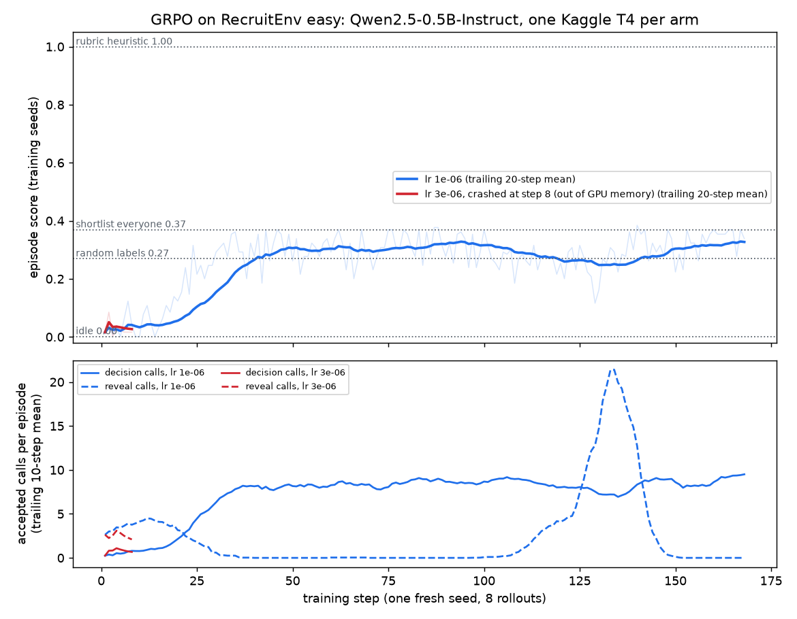
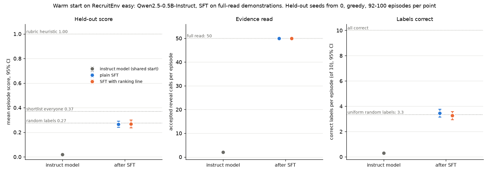

# Training on RecruitEnv

Two runs of Qwen2.5-0.5B-Instruct on the **easy** task, each on a free Kaggle T4 notebook.

- **Run 1, GRPO from the instruct model (2026-11-26/27).** Training reward rose from 0.06 to 0.33 and stopped just below the score of shortlisting everyone blind (0.369). The model learned to label the pool without reading. Its episode limits only allowed about 18 of 50 reveals.
- **Run 2, supervised warm-up on reading demonstrations (2026-11-27/28).** On held-out seeds the model makes 50 accepted reveal calls and decides everyone in every episode, but its labels are no better than chance: 0.27, below the blind line. Reading is learnable by imitation; judging the evidence was not, at this size and with this data.

## Run 1: GRPO from the instruct model

One GRPO run of Qwen2.5-0.5B-Instruct on the **easy** task, on a free Kaggle T4, 2026-11-26/27. All numbers are **training reward on training seeds** (10,000 onwards; every step draws a fresh seed, so each step's episode is unseen when it is played). This is not a held-out evaluation.



### Result

**The model learned to label the pool. It did not learn to triage.** Its score rose from 0.06 to about 0.33, close to 0.369, the score of shortlisting every candidate without reading anything. Every 20-step window averages below that line; 3 single steps of 168 went above it (at most 0.385), with 0–1 accepted reveal calls per episode. By the end the model made no accepted reveal calls.

| Steps | Mean score | Within-group spread | Accepted reveal calls per episode | Accepted decision calls per episode | Steps where all 8 rollouts scored exactly 0.3692 |
|---|---|---|---|---|---|
| 1–20 | 0.056 | 0.081 | 3.64 | 1.46 | 0 |
| 21–40 | 0.266 | 0.125 | 0.30 | 7.22 | 0 |
| 41–60 | 0.304 | 0.108 | 0.02 | 8.21 | 2 |
| 61–80 | 0.310 | 0.099 | 0.00 | 8.49 | 5 |
| 81–100 | 0.316 | 0.113 | 0.04 | 8.66 | 1 |
| 101–120 | 0.265 | 0.133 | 2.57 | 8.46 | 0 |
| 121–140 | 0.264 | 0.127 | 13.72 | 7.80 | 0 |
| 141–160 | 0.316 | 0.100 | 0.06 | 8.61 | 3 |
| 161–168 | 0.348 | 0.049 | 0.00 | 9.45 | 3 |

- **Early versus late.** The last 20 steps average 0.271 more than the first 20 (95% bootstrap interval over steps +0.242 to +0.298). The interval treats steps as independent, which they are not quite, so it is somewhat optimistic. The rise itself is not in doubt.
- **Blind labelling.** Shortlisting everyone scores exactly 0.3692 on every one of the 1,000 training seeds. In 14 of the 168 steps, all 8 rollouts scored exactly that, including 5 of the last 20.
- **A reveal burst.** Around steps 110–145, accepted reveal calls rose to about 20 per episode, the score dipped to about 0.25, and then they went back to zero. No rollouts were saved in this run, so the logs cannot say what the model did with what it read.
- **Many failed calls.** From step 40 on, the model made a median of 24 tool calls per episode (10–60), and a median of 59% of them failed (22–79%). TRL counts as failed both calls the environment refused and malformed calls that never reached it; the logs record the rate, not the reasons. Completions grew to a median of about 900 tokens, and a step took a median of 180 s, against 74 s for the first step.

#### What this says about the environment

- The reward gives GRPO a usable signal from a weak start. Within-group spread was above zero on 150 of 168 steps.
- Blind labelling does poorly on easy. The blind policies measured here average at most 0.369 and pass (score ≥ 0.5) on 0–3% of seeds, while the rubric heuristic, which reads, scores 0.999 and passes every seed. A model that stops near the blind line has learned the format, not the job, and the score shows it.
- In this one run, a pretrained 0.5B instruct model fine-tuned with GRPO, without a supervised warm-up, settled just below the blind line (0.30–0.35) within about 40 steps and did not get past it in 168.

#### What the run's limits allowed

**A model could not have read everything in this run.** Reading every source of every candidate takes 50 reveal calls and 10 decisions; that episode is about 6,000 completion tokens. The run allowed 2,560 completion tokens (all turns and tool results) per episode.

How much reading fitted: the rubric heuristic, stopped after *k* reveals and then labelling everyone by its estimates, rendered the way TRL renders it (one call per turn), on training seeds 10,000–10,099:

| Reveals before deciding | Completion tokens (median, max) | Mean score | Pass rate (≥ 0.5) |
|---|---|---|---|
| 10 | 1,536, 1,548 | 0.430 | 0.30 |
| 14 | 1,931, 2,045 | 0.466 | 0.32 |
| 16 | 2,129, 2,283 | 0.490 | 0.32 |
| 18 | 2,349, 2,551 | 0.515 | 0.41 |
| 20 | 2,562, 2,767 | 0.516 | 0.37 |

So about 18 reveals fitted, and a good reading policy within the limits scores about 0.5, not 0.999. The heuristic is not proven optimal for a fixed number of reveals, so 0.5 is a reference, not a ceiling. The run therefore left a gap of about 0.15 between the blind line (0.369) and what reading could reach, not 0.63. The second run (below) raises the limits so a full read fits.

### Reference scores on the training seeds

From `scripts/training_references.py --task easy --seeds 10000:11000` ([references.json](training/references.json)):

| Policy | Mean score | Pass rate (≥ 0.5) |
|---|---|---|
| Idle (no decisions) | 0.001 | 0.00 |
| Shortlist everyone | 0.369 | 0.00 |
| Hold everyone | 0.246 | 0.00 |
| Reject everyone | 0.185 | 0.00 |
| Blind quota fill (id order) | 0.267 | 0.03 |
| Random labels | 0.269 | 0.02 |
| Rubric heuristic | 0.999 | 1.00 |
| Oracle | 0.999 | 1.00 |

### Setup

| Item | Value |
|---|---|
| Model | `Qwen/Qwen2.5-0.5B-Instruct`, full fine-tune, fp32, gradient checkpointing |
| Precision note | The T4 has no native bf16, though `torch.cuda.is_bf16_supported()` returns True on it. bf16 was not tried; `--precision auto` uses fp32 below compute capability 8.0. |
| Algorithm | TRL 1.19.0 `GRPOTrainer` with `environment_factory=RecruitToolEnv` (tool-calling rollouts) |
| Per step | one fresh seed, 8 rollouts (`num_generations 8`, micro-batch 4, gradient accumulation 2) |
| Limits | 2,560 completion tokens per episode (all turns and tool results), 40 tool-calling turns |
| Learning rate | 1e-6 (the 3e-6 arm crashed, see below) |
| Hardware | Kaggle notebook, 2 × Tesla T4 (one arm per GPU), private |
| Software | Python 3.13.16, torch 2.11.0+cu130, transformers 5.20.2, TRL 1.19.0, recruitenv 4.0.0 |
| Wall clock | 600 minutes of training (the `--max-minutes` limit), 168 steps |
| Peak GPU memory | 11.5 GB |

The script that ran is byte-identical to `examples/train_grpo.py` at commit `47fc093`. The launch command was:

```
python scripts/kaggle_train.py push --slug recruitenv-grpo-easy \
  --arm "lr1e-6=--learning-rate 1e-6" --arm "lr3e-6=--learning-rate 3e-6" -- \
  --task easy --max-steps 1000 --episodes 1000 --num-generations 8 --batch-size 4 \
  --grad-accum 2 --max-completion-length 2560 --max-tool-calls 40 \
  --stop-flat-steps 30 --max-minutes 600
```

Raw outputs for both arms (curve CSV, every logged metric, run info, console log) are in [`training/run-2026-11-27/`](training/run-2026-11-27/). The plot and [summary.json](training/summary.json) are regenerated with:

```
uv run scripts/training_report.py --run docs/results/training/run-2026-11-27 \
  --references docs/results/training/references.json --out docs/results/training
```

### What did not work

- **The 3e-6 arm ran out of GPU memory at step 8**, 46 minutes in. GPU memory grows with the longest episode in a step, and episodes grew later, after the 5-step smoke test had passed at 10.2 GB. It says nothing about the learning rate.
- **1e-5 collapsed in a 5-step smoke test**: by step 4 all 8 rollouts made the same single decision and scored the same, so there was no gradient. That is one short run, not a sweep.

## Run 2: supervised warm-up, then a held-out evaluation

Design record: [2026-11-27-warm-start-design.md](../superpowers/specs/2026-11-27-warm-start-design.md).



### What was trained

- **Demonstrations.** `rubric_full_read` plays seeds 10,000–10,999: it reads all five rubric sources of each candidate in a fixed order per role, then labels everyone by the rubric. Every demonstration scores 0.999. Each is written as the conversation TRL would build: one assistant turn per candidate with five tool calls, one turn with the ten decisions, and a closing line (11 tool turns, about 6,500 tokens).
- **Two arms, one per T4.**
  - **plain:** the demonstrations as they are.
  - **ranking:** the decision turn first writes the candidates ranked by the rubric estimate, for example `Ranking by the rubric: candidate_009 0.38, candidate_010 0.35, ...`. This shows the model the aggregation step.
- **SFT.** Full fine-tune, 2 epochs, 250 optimizer steps of 8 demonstrations. Learning rate 1e-5 with cosine decay, Adafactor, fp16 mixed precision, gradient checkpointing. 133 minutes (plain) and 129 minutes (ranking), peak GPU memory 5.4 GB. Loss on assistant tokens fell from 0.071 to 0.005 (plain) and from 0.130 to 0.021 (ranking).
- **Evaluation.** Held-out seeds from 0 (evaluation seeds; no overlap with training seeds), greedy decoding, one episode per seed. Limits: 20 tool turns, 7,000 completion tokens, 512 tokens per assistant turn. Each evaluation had a 120-minute limit and stopped after 97 (plain) and 92 (ranking) episodes, at about 75 seconds an episode. The instruct model before SFT is the control (100 episodes).

### Result

| Model | Episodes | Mean score (95% CI) | Minus shortlist-everyone (95% CI) | Pass rate (≥ 0.5) | Accepted reveals | Decided | Correct labels (of 10) | True shortlists among its 3 | Failed tool calls |
|---|---|---|---|---|---|---|---|---|---|
| Instruct model | 100 | 0.019 (0.014–0.025) | −0.350 | 0.00 | 2.0 | 0.8 | 0.3 | 0.0 | 44% |
| plain SFT | 97 | 0.267 (0.241–0.293) | −0.103 (−0.128 to −0.077) | 0.05 | 50.0 | 10.0 | 3.5 | 0.9 | 0% |
| SFT with ranking line | 92 | 0.269 (0.238–0.301) | −0.101 (−0.132 to −0.068) | 0.07 | 50.0 | 10.0 | 3.3 | 1.0 | 0% |

References on the same seeds (`scripts/training_references.py --seeds 0:100`, [references_eval.json](training/references_eval.json)): shortlist everyone 0.369, random labels 0.275, blind quota fill 0.263, rubric heuristic 0.999. Uniform random labels get 3.3 of 10 right on average, and a random shortlist of 3 holds 0.9 true shortlists.

- **The format and the reading transferred.** After SFT, every evaluated episode made 50 accepted reveal calls and all 10 decisions, made no failed tool call and closed with a final message. The evaluation counts accepted calls, and the environment also accepts repeated reveals; in the six transcripts the evaluation kept (seeds 0–2 of each arm), the 50 calls were the 50 distinct rubric sources, and the labels matched the quotas exactly (3 shortlist, 4 hold, 3 reject). Against the instruct model on the same seeds, the score rose by 0.247 (plain, 95% CI +0.220 to +0.273) and 0.248 (ranking, +0.216 to +0.282).
- **The judgement did not.** Both arms label at chance: 3.5 and 3.3 correct labels of 10, and 0.9 and 1.0 true shortlists among their three. Their scores (0.27) sit on the random-labels line and below shortlisting everyone (0.369); on easy, reading everything and then labelling at random scores worse than not reading and shortlisting everyone.
- **The ranking line was imitated, not computed.** The ranking arm writes a well-formed ranking with plausible numbers before every decision turn. In the three episodes whose full text the evaluation kept (seeds 0–2), the rank correlation between the model's ranking and the true rubric ranking was −0.02, 0.07 and 0.16, and the model's rankings on seeds 0 and 2 list the candidates in nearly the same order.
- **No difference between the arms was detected.** On the 92 seeds both evaluated, ranking minus plain is +0.003 (95% CI −0.040 to +0.046).

### What did not work, and pilots

Four short pilots (about 2.2 GPU hours) came before the full run:

- **Full fine-tuning with AdamW ran out of memory** on a T4 at about 6,600 tokens. Adafactor, which keeps almost no optimizer state, fixed the optimizer part.
- **Attention ran out of memory.** With no padding mask, transformers asks SDPA for grouped-query attention (`enable_gqa`; Qwen2.5 has 14 query heads and 2 key/value heads). On a T4 that only runs on the math kernel, which builds the full score matrix: about 2.3 GB per layer at 6,600 tokens. `examples/warm_start.py` now makes transformers repeat the key/value heads, and allows only the memory-efficient kernel during SFT. Peak memory fell from 13.9 GB (then out of memory) to 5.4 GB.
- **fp32 SFT was slow:** about 17 seconds per demonstration against about 4 in fp16 mixed precision.
- **GRPO after SFT was not tried in the full run.** In one pilot, one GRPO step (8 rollouts, 2 per micro-batch, up to 7,000 completion tokens) took 21 minutes, and the second step ran out of memory in attention. That pilot started from a model trained on only 16 demonstrations, which did not end its turns, so its rollouts ran to the length limit; it also ran before the attention fix above, which `train_grpo.py` does not have. It was not re-measured, so the speed of GRPO from the final SFT model is unknown, and the pipeline's `--grpo` stage is untested beyond that one step.
- **An SFT model trained on 16 demonstrations** read the first candidate's five sources and then repeated reads without stopping. After 64 demonstrations, 8 pilot episodes each made 50 accepted reveal calls, and 5 of the 8 went on to decide.

### Reproduce

```
python scripts/kaggle_train.py push --slug recruitenv-warm-start --script warm_start.py \
  --arm "plain=--base-eval" --arm "ranking=--ranking" -- \
  --sft-episodes 1000 --sft-epochs 2 --sft-grad-accum 8 --sft-precision fp16 --seeds 0:100 --eval-minutes 120
```

The notebook ran 274 minutes. Raw outputs for both arms (pipeline status, SFT log, every evaluated episode with three full transcripts, console logs) are in [`training/run-2026-11-28-warm/`](training/run-2026-11-28-warm/). The trained weights stay in the private Kaggle notebook's output. The plot and [warm_start_summary.json](training/warm_start_summary.json) are regenerated with:

```
uv run scripts/warm_start_report.py --run docs/results/training/run-2026-11-28-warm \
  --references docs/results/training/references_eval.json --out docs/results/training
```

## What the two runs say about the environment

- **The score separates reading from judging.** The blind policies measured average at most 0.369 (and pass on 0–4% of seeds); one that reads everything and labels at random scores about 0.27; only a model that weighs the evidence passes. Neither run reached the third kind, and the score says so.
- **The hard part is the aggregation.** Imitation taught a 0.5B model the whole tool protocol, including 60 calls in the right order, from 1,000 examples. It did not teach it to turn 50 revealed numbers into the rubric's ranking, even when the demonstrations wrote that ranking out.

## Next steps (not done here)

- **Teach the aggregation with a denser signal.** For example SFT on the ranking line alone, with many more examples than episodes, or a reward on the ranking's rank correlation before the decisions.
- **A larger model** (1.5B–3B with LoRA) for the same SFT. This needs a GPU with more memory or LoRA plus the attention fix above.
- **GRPO from the SFT model.** First time one step from the final SFT checkpoint with the attention fix added to `train_grpo.py`; if it is still slow on a T4, use a faster GPU (TRL's vLLM generation needs a newer one).
- **Medium and hard**, where the budget does not cover a full read, so choosing what to read matters.
- **Run 1's failed tool calls.** Save rollouts (`--log-completions`) to find out why most late calls failed.
